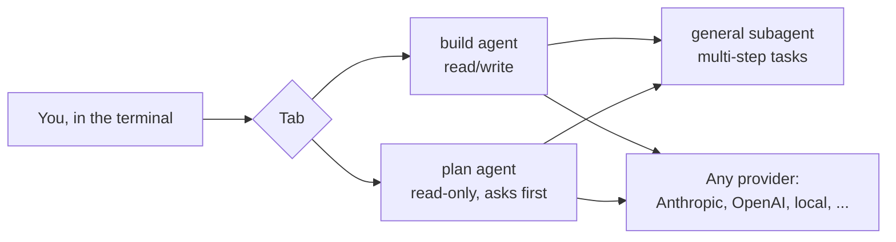

<p align="center">
  
</p>

<h3 align="center">Renx</h3>
<p align="center">Any AI model. One terminal. Zero lock-in.</p>

<p align="center"><b>🚧 Work in progress — not installable yet. No releases, no package, no live build. 🚧</b></p>

---

## What it is

Renx is a terminal tool for working with AI models directly from the command line — provider-agnostic, so you're not locked into one model or company.

## How it works (planned)

Two agents, switchable with `Tab`:

- **build** — full read/write access, for making actual changes
- **plan** — read-only; explores and proposes changes without touching files, and asks before running shell commands

Plus a **general** subagent for open-ended, multi-step tasks.



## Status

Early development. Nothing here is published or ready to run yet — check back, or watch/star the repo to follow progress.

## Run from source

Not working yet. The monorepo is mid-rename from opencode to renx, and the root `package.json` doesn't declare the Bun workspaces yet, so `bun install` can't link the packages. Once that's fixed, it will be:

```bash
bun install   # needs Bun 1.3 or newer
bun run dev
```

## Credits

Renx is built on [opencode](https://github.com/anomalyco/opencode), the open-source AI coding agent, and keeps its MIT licence. See [LICENSE](LICENSE).

## Contributing

Interested in contributing? Open an issue or a pull request.
